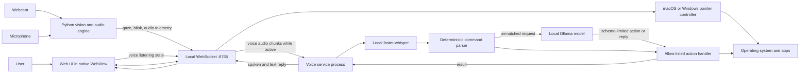
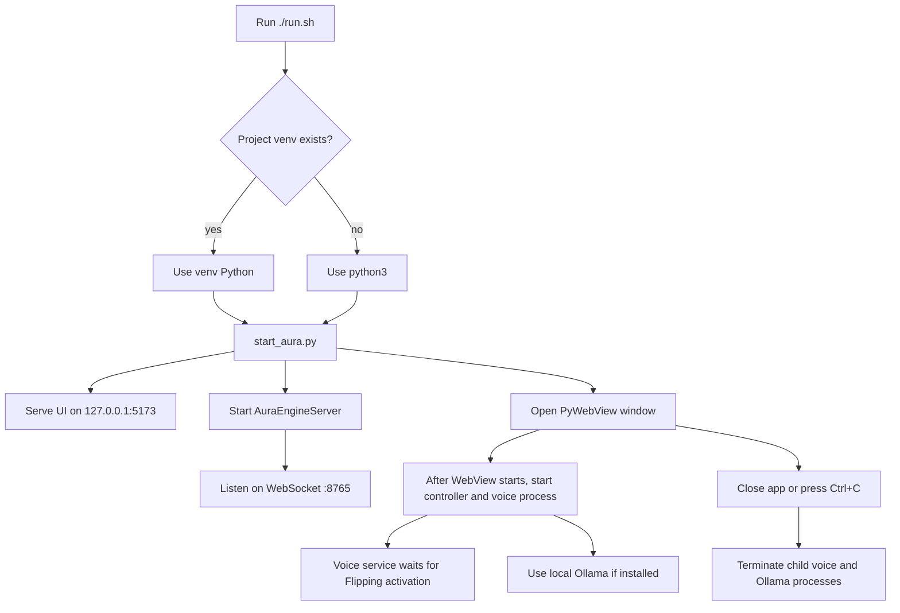
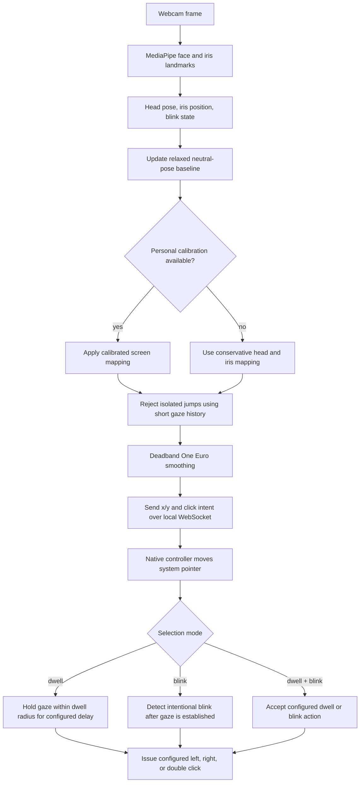
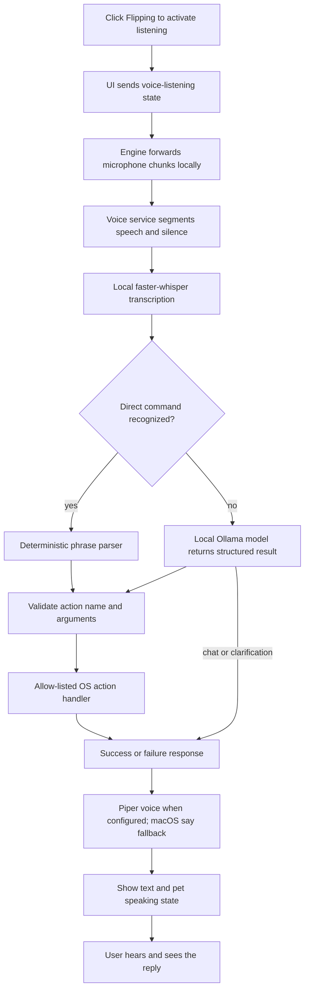

# AURA

**AURA (Adaptive User Response Assistant) is a local-first desktop accessibility prototype.** It combines webcam-based gaze control, dwell and blink selection, optional acoustic click detection, and a voice companion that can perform a constrained set of desktop actions.

The project runs as a small group of local services: a Python vision and audio engine, a browser-based interface served on loopback, a native operating-system pointer controller, and a separate voice-assistant process. The interface is named **Flipping**. Camera and microphone analysis stays on the computer; flexible voice interpretation can use a locally installed Ollama model.

> AURA is a prototype. Behavior depends on the camera, lighting, display, operating-system permissions, and local model setup. The project has diagnostic and integration scripts, but this README does not claim that they have been run on every supported platform.

## Contents

- [What AURA does](#what-aura-does)
- [Architecture](#architecture)
- [Runtime flows](#runtime-flows)
- [Technology](#technology)
- [Repository layout](#repository-layout)
- [Requirements](#requirements)
- [Setup](#setup)
- [Run AURA](#run-aura)
- [First-use checklist](#first-use-checklist)
- [Voice assistant](#voice-assistant)
- [Gaze, selection, and calibration](#gaze-selection-and-calibration)
- [Privacy and local data](#privacy-and-local-data)
- [Troubleshooting](#troubleshooting)
- [Known limitations](#known-limitations)

## What AURA does

- **Tracks gaze from a webcam.** MediaPipe Face Landmarker supplies face and iris landmarks. AURA combines eye features with head pose, establishes a relaxed neutral pose, and maps gaze into screen coordinates.
- **Calibrates the mapping.** The UI guides the user through a nine-target calibration. The engine fits and evaluates a personal gaze mapping, then saves it locally.
- **Stabilizes cursor movement.** A short history rejects isolated landmark jumps. A deadband One Euro filter smooths small movements while preserving faster movement across the screen. The operating-system controller applies additional safeguards and, on macOS, accessibility-based magnetic friction around detected controls.
- **Selects without a mouse.** Choose dwell selection, blink selection, or both. Dwell delay and click type are configurable in the UI. The separate acoustic click classifier can be trained with click and noise samples.
- **Listens when Flipping is active.** AURA owns one microphone stream. The UI sends the voice-listening state; the engine forwards audio chunks to the voice service only during an active Flipping session. Local Whisper transcribes speech. Direct phrases go through AURA's command parser first; other requests can go to the local Ollama model, which returns a constrained action or a reply.
- **Performs desktop actions.** Allow-listed handlers support app launch and switching, window minimize/maximize, scrolling, clicks, search, and zoom. Flipping reports whether the handler succeeded or failed.
- **Provides a visual demo.** The landing page includes the animated pet, calibration, selection settings, and a Bubble Wrap sandbox for trying gaze targeting without using another app.

## Architecture



### Runtime components

| Component | Role |
| --- | --- |
| `start_aura.py` | Starts the local UI server, Python engine, native WebView, OS controller, and voice child process. It also sets local voice model paths and starts Ollama if available. |
| `server.py` | Owns webcam and microphone capture, gaze and acoustic processing, calibration messages, and the WebSocket endpoint at `127.0.0.1:8765`. |
| `face_tracker.py` | Extracts face, iris, head-pose, and blink features using MediaPipe. |
| `calibration.py` | Fits the gaze-to-screen mapping and reports calibration diagnostics. |
| `one_euro_filter.py` | Filters cursor coordinates and suppresses small jitter. |
| `macos_controller.py` / `windows_controller.py` | Consume engine telemetry and issue native pointer, click, dwell, scroll, and related OS events. |
| `voice_commander.py` | Runs local speech recognition, command interpretation, validated desktop actions, and spoken replies in its own process. |
| `index.html` and `style.css` | Provide the current landing page, Flipping UI, calibration overlays, controls, and demo. The active UI logic is embedded in `index.html`. |
| `models/face_landmarker.task` | MediaPipe task model used for face and iris landmark detection. |

`app.js` is an older standalone UI implementation and is not loaded by the current `index.html`. `run.sh` starts `start_aura.py`; `aura_app.py` is an alternate launcher. The older `gaze_engine.py` and `quick_calibrate.py` files are optional/experimental alternatives and are not used by the main nine-target UI calibration path. The floating camera, eye-cursor, and pet overlays are retained as prototype helpers; the alternate launcher starts them only on Windows. `Cargo.toml`, `main.rs`, and `tauri.conf.json` are Tauri scaffolding and are not part of the current Python/PyWebView runtime.

## Runtime flows

### Startup and service lifecycle



### Gaze-to-pointer flow



The uncalibrated path is intentionally conservative. Run calibration after changing seating position, camera placement, or lighting. The calibration diagnostics are useful for comparing sessions; they are not a guarantee of a particular accuracy on every machine.

### Voice command and reply flow



The model does not call arbitrary shell commands. For a desktop action, it can only request one of the explicit tools that AURA validates again before execution.

## Technology

- **Python** for the launcher, vision/audio engine, calibration, command parsing, and OS control.
- **MediaPipe Tasks Vision** for face, iris, and blendshape landmarks.
- **OpenCV** for webcam frames.
- **NumPy, SciPy, and scikit-learn** for numerical processing and gaze calibration.
- **One Euro filtering** plus a spatial deadband for cursor smoothing.
- **sounddevice and librosa** for microphone capture and acoustic click classification.
- **faster-whisper** for local speech-to-text.
- **Ollama** with a locally installed model for flexible phrasing and conversational replies.
- **Piper TTS** for an optional local voice; on macOS AURA falls back to the built-in `say` speech service when Piper is unavailable.
- **WebSockets** for local UI, engine, controller, and voice-service messages.
- **PyWebView** for a native window around the local web interface.
- **Quartz / Accessibility APIs** on macOS and **Win32 / UI Automation** on Windows for desktop control.

The Rust/Tauri files are scaffolding rather than active dependencies in the current launcher.

## Repository layout

```text
AURA/
├── index.html                 # Current landing page, UI logic, calibration and demo
├── style.css                  # UI styling
├── home_background.png        # Landing-page background artwork
├── run.sh                     # Portable shell entry point
├── start_aura.py              # Main launcher and local service lifecycle
├── server.py                  # Camera, microphone, processing and WebSocket engine
├── face_tracker.py            # MediaPipe face, gaze, head-pose and blink features
├── calibration.py             # Gaze calibration model and diagnostics
├── one_euro_filter.py         # Cursor smoothing filter
├── classifier.py              # Acoustic click/noise classifier
├── voice_commander.py         # Local speech assistant and validated action handlers
├── macos_controller.py        # macOS native pointer and accessibility controls
├── windows_controller.py      # Windows native pointer and accessibility controls
├── system_controller.py       # Platform controller selection/fallback
├── aura_app.py                # Alternate launcher
├── cursor_overlay.py          # Cursor overlay helper
├── camera_overlay.py          # Optional Windows camera preview overlay
├── eye_cursor_overlay.py      # Optional Windows gaze reticle overlay
├── floating_pet.py            # Optional Windows desktop pet overlay
├── gaze_engine.py             # Earlier experimental gaze mapping/filter
├── quick_calibrate.py         # Earlier standalone five-point calibration utility
├── diagnostics_harness.py     # Numerical and filter diagnostics
├── test_system_integration.py # Integration checks
├── models/
│   ├── face_landmarker.task   # MediaPipe face model
│   └── voice/                 # Downloaded Whisper and Piper assets (ignored by Git)
├── Cargo.toml / main.rs       # Inactive Tauri scaffolding
└── requirements.txt           # Python dependencies
```

Calibration and acoustic classifier state are saved locally under `models/`. Downloaded voice-model weights are intentionally excluded from Git; setup instructions below recreate them.

## Requirements

- macOS or Windows. The native controllers are platform-specific; other operating systems are not currently documented as supported.
- Python 3.9 or newer. A compatible Python version is required by MediaPipe and the other pinned-minimum dependencies.
- A webcam and microphone.
- A display and a well-lit face position for gaze tracking.
- macOS: camera, microphone, and Accessibility permissions for the application/Python process controlling the pointer.
- Windows: camera and microphone permissions; grant any OS-level permission requested for pointer control.
- For flexible local voice chat: Ollama and enough memory/disk space for the model selected. The documented default Qwen model download is several gigabytes.

## Setup

Run these commands from the repository directory.

### 1. Create an environment and install dependencies

macOS/Linux shell:

```bash
python3 -m venv venv
./venv/bin/python -m pip install --upgrade pip
./venv/bin/python -m pip install -r requirements.txt
```

Windows PowerShell:

```powershell
py -m venv venv
.\venv\Scripts\python.exe -m pip install --upgrade pip
.\venv\Scripts\python.exe -m pip install -r requirements.txt
```

On macOS, install the native frameworks used for camera permissions, Quartz events, and Accessibility:

```bash
./venv/bin/python -m pip install pyobjc-framework-Quartz pyobjc-framework-ApplicationServices pyobjc-framework-AVFoundation
```

### 2. Install local voice models (optional, for Flipping speech)

Install [Ollama](https://ollama.com/) separately, then fetch the local chat model:

```bash
ollama pull qwen3.5:4b
```

Download the Whisper speech-recognition model into the ignored `models/voice` folder:

```bash
./venv/bin/python -m pip install huggingface_hub
./venv/bin/python -c 'from huggingface_hub import snapshot_download; snapshot_download(repo_id="Systran/faster-whisper-small.en", local_dir="models/voice/whisper-small.en")'
```

For the optional Piper voice, download an English voice:

```bash
./venv/bin/python -m piper.download_voices en_US-lessac-medium --data-dir models/voice
```

Whisper and Piper assets are downloaded separately because their model files are large and may have distinct distribution terms. Review the selected model/voice license before redistributing its weights. Without Piper, macOS uses the built-in `say` voice. Without Ollama, direct phrase commands may still work, but flexible language interpretation and local model chat will not.

## Run AURA

```bash
./run.sh
```

The launcher prefers the project-local virtual environment (`venv`). If it does not exist, it runs `python3`, which must already have the dependencies installed. You can also launch explicitly:

```bash
./venv/bin/python start_aura.py
```

The local web interface is served at `http://127.0.0.1:5173`; the telemetry and control WebSocket listens at `ws://127.0.0.1:8765`. When PyWebView is installed, AURA opens a native desktop window. If native window creation fails, it opens the local page in the default browser. Keep the launcher process running while using AURA; Ctrl+C in its terminal stops the services.

The launcher starts the voice child process and tries to start Ollama if the Ollama executable is installed. It does not download models automatically. Avoid starting a second copy while these local ports are occupied.

### macOS permissions

Allow camera and microphone access when macOS prompts. For system pointer movement, clicks, window operations, and related desktop actions, add the AURA/Python host shown in the prompt to **System Settings → Privacy & Security → Accessibility**. A terminal-hosted Python app can appear under Terminal, Python, or the terminal application that launched it. Restart AURA after changing permissions.

## First-use checklist

1. Launch AURA and grant camera/microphone access.
2. Confirm the camera and face indicator show a live face.
3. Sit in a comfortable, repeatable position and complete the nine-target gaze calibration. Keep your eyes on each target until the UI advances.
4. Start with a slower dwell time and **Dwell + blink** mode. Change the dwell delay and click type in the landing-page controls if needed.
5. Use the Bubble Wrap demo to check cursor targeting and selection before controlling another application.
6. Grant Accessibility permission and verify a harmless pointer movement/click in a safe window.
7. Install and load the local voice models, activate Flipping, then try a simple voice action such as “scroll down” or “minimize Chrome.”

The supported native controller has a Space-key emergency toggle. If the cursor moves unexpectedly, press Space or stop AURA from its launcher terminal.

## Voice assistant

Click the Flipping pet to start or pause the voice session. When active, Flipping stays ready for speech; AURA’s microphone stream is forwarded to the separate local speech process only during that active session. After a command, Flipping speaks a response and displays it in the chat panel.

Examples to try:

| Say | Expected action |
| --- | --- |
| “Open Safari” | Launch Safari. |
| “Switch to Chrome” | Bring Chrome to the foreground. |
| “Minimize Chrome” | Minimize a matching Chrome window. |
| “Maximize Safari” | Zoom/maximize a matching Safari window. |
| “Minimize this window” | Minimize the active window. |
| “Minimize AURA” | Hide the AURA window while its background voice process remains available. |
| “Restore AURA” / “Show AURA” | Bring AURA back. |
| “Scroll down” / “Scroll left” | Send a scroll event to the active desktop context. |
| “Right click” / “Double click” | Click at the current pointer position. |
| “Zoom in” / “Zoom out” | Toggle the platform zoom feature. |
| “Search for …” | Open system search and enter a query. |
| “Help” | Hear a short overview of supported actions. |

Direct commands are matched by the local parser. If a request uses different wording, the local Ollama model interprets it and may select only from a small allow-list (open/switch/minimize/maximize, scroll, click, search, and zoom). AURA validates the requested tool and its arguments before acting. The app reports action failure instead of intentionally claiming success. “Minimize all windows” currently applies to the active application on macOS; behavior differs by operating system.

Flipping uses English Whisper by default. You can set alternate model paths with `AURA_WHISPER_MODEL`, `AURA_PIPER_VOICE`, and `AURA_LOCAL_MODEL`. The documented defaults are configured by `start_aura.py`.

## Gaze, selection, and calibration

The vision engine detects facial landmarks and derives head pose, iris position, and blink state. During startup it observes a short neutral baseline. During calibration, the UI presents nine screen targets and the user looks at each one; the engine collects feature/target pairs, fits a screen mapping, computes diagnostics, and saves the model to `models/gaze_calibration.joblib`.

If no usable personal calibration is loaded, AURA falls back to a conservative hybrid mapping based on relative head and iris motion. A short gaze history and the One Euro filter reduce tracking jitter. On macOS the controller can apply additional magnetic friction over accessible buttons without forcibly snapping the cursor to their centers.

Selection options:

- **Dwell:** Hold the gaze cursor inside a small radius for the selected delay; choose left, right, or double click.
- **Blink:** Use an intentional blink after gaze tracking is established.
- **Dwell + blink:** Enable both selection methods.
- **Acoustic click selection:** Separately train the click/noise classifier from recorded samples. It uses a confidence threshold and sustained audio gate to reduce false clicks. This model is distinct from Whisper and does not learn spoken commands.

Calibration and click-model assets are local. Recalibrate if camera position, seating, lighting, or screen geometry changes.

## Privacy and local data

- Webcam frames are processed by the local Python service and are not sent to a cloud vision service by this project.
- The optional Windows camera-preview helper reads a local, ignored `.preview_frame.jpg` written by the engine; this preview is not uploaded by AURA.
- Microphone input is consumed locally by the AURA engine. Speech chunks are forwarded to the local voice process only while Flipping listening is active.
- Whisper speech recognition and Piper speech synthesis run locally when installed. Ollama is contacted through `127.0.0.1`; the configured model must be downloaded separately.
- OS actions are issued locally through platform APIs and input events.
- Gaze calibration and acoustic classifier data are saved under `models/`. Whisper/Piper model files under `models/voice/` are ignored by Git.
- The repository does not configure an OpenAI or xAI cloud endpoint for this voice path.

## Troubleshooting

| Symptom | Checks |
| --- | --- |
| No camera image / no face | Confirm camera permission, close applications holding the camera, improve lighting, and check that the MediaPipe task asset exists. Restart AURA after permission changes. |
| Cursor does not move | Confirm calibration completed, face tracking is live, the correct OS controller started, and Accessibility permission is granted. Use the Space emergency toggle to re-enable control if it was paused. |
| Cursor drifts or jitters | Re-run calibration with the camera in its final position; keep a stable head position and lighting; adjust dwell/filter settings only after tracking is established. |
| Dwell click does not happen | Confirm dwell is enabled, the selected mode includes dwell, the cursor stays within the dwell radius long enough, and the controller is connected. |
| Blink click does not happen | Select a mode including blink, look at a stable point first, and try a clear intentional blink. |
| Flipping does not transcribe | Activate Flipping, check microphone permission/input level, ensure `faster-whisper` is installed, and confirm `models/voice/whisper-small.en` exists or `AURA_WHISPER_MODEL` points to a valid model directory. |
| Flipping transcribes but cannot interpret flexible wording | Start Ollama, run `ollama list`, and verify the selected model is present. Direct parser phrases can work without Ollama. |
| Flipping speaks with the wrong or no voice | Install Piper and point `AURA_PIPER_VOICE` to its `.onnx` file; on macOS, check built-in speech availability as a fallback. |
| Minimize/maximize or other OS action fails | Check that the target app/window is open and Accessibility permission is granted. For AURA, try “restore AURA” if its window has been minimized. |
| Port already in use | Stop the other AURA process using port 5173 or 8765 before launching another instance. |

## Known limitations

- Gaze accuracy is personal and camera-dependent; calibration metrics should be validated on the target setup.
- Native window, accessibility, and pointer APIs differ between macOS and Windows. Not every app exposes its controls to Accessibility APIs.
- macOS “minimize all windows” currently operates on the active app’s windows, not every window on every Space.
- Voice support requires separately downloaded speech and chat models. Without the local SLM, flexible paraphrases and chat are unavailable.
- Acoustic click selection is a separate optional classifier; it is not the voice assistant and is not trained from spoken commands.
- The 3× dwell magnifier, native accessibility-grid snapping, full cursor-persona system, and acoustic “shhh” snooze detector are not complete in the primary launcher. Separate floating camera, reticle, and pet overlays are prototype helpers available through the alternate Windows launcher. Easter-egg behavior is experimental.
- `diagnostics_harness.py` and `test_system_integration.py` are available for validation, but their status depends on the target machine and permissions. No test pass is implied by this documentation.

## Contributing and reporting issues

When reporting a problem, include the operating system/version, Python version, launcher output, camera/controller status, whether calibration completed, and whether the issue reproduces in the Bubble Wrap demo. Do not attach voice recordings, calibration files, or other personal data unless you intend to share them.
